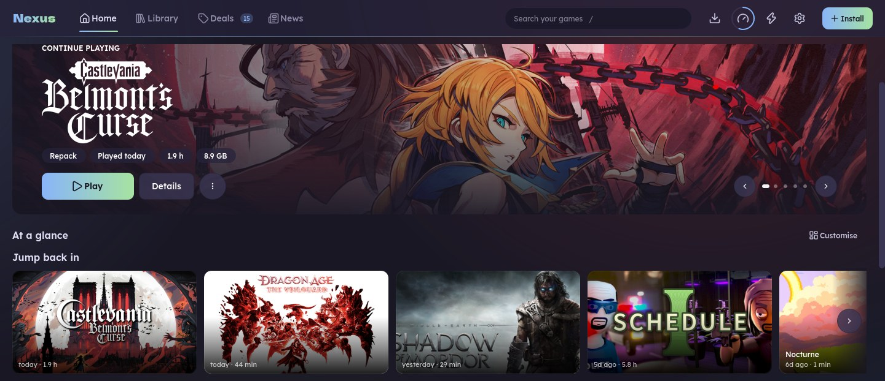
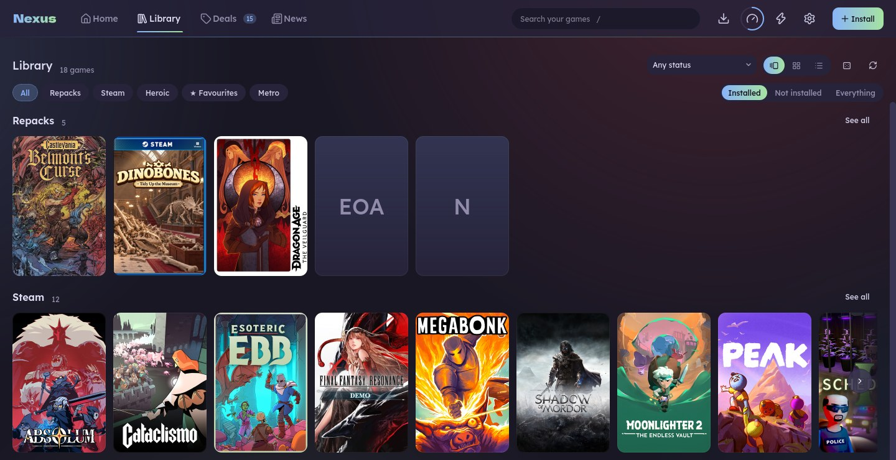

# Nexus

One launcher for all your PC games. Nexus puts your Steam and Epic games (and on Linux your
Heroic games) in one library, installs games from their Windows setup files, and keeps
everything tidy: artwork, play time, saves, disk space. It has a TV-friendly Theatre mode
for playing from the couch with a controller.

It runs on **Linux** (the main platform) and **Windows** (a newer edition, called
*nexus-launcher* there).



> Nexus is an unofficial hobby project, not affiliated with Valve, Epic, Heroic or any
> store. It never downloads games by itself. Only install software you are allowed to use.
> MIT licensed, see [LICENSE](LICENSE).

## What it does

| | Linux | Windows |
|---|:---:|:---:|
| One library for Steam and Epic games, with artwork, play time and achievements | ✓ (Epic through Heroic) | ✓ |
| Install a game from its `setup.exe` and add it to the library | ✓ (runs under Proton) | ✓ (runs natively) |
| Theatre mode for the TV, with controller support | ✓ | ✓ |
| Storage cleanup, health checks, move and back up games and saves | ✓ | ✓ |
| Downloads from your torrent client (Transmission or qBittorrent) | ✓ | ✓ |
| Deals, upcoming releases and backlog picks (needs a [Game-db](#game-db) server) | ✓ | ✓ |
| Background alerts, tray icon, Discord status, phone notifications | ✓ | ✓ |
| Proton manager, per-game tuning (gamescope, MangoHud, …), Sunshine streaming | ✓ | — |



## Install

### Windows

Download the latest installer from the
[Releases page](https://github.com/cyberpunk89/nexus-launcher/releases)
(`nexus-launcher-Setup-<version>.exe`, Windows 10 or 11, 64-bit). It installs just for you,
with no admin prompt. A portable zip is there too.

The build isn't code-signed, so SmartScreen may warn you the first time: click
**More info → Run anyway**. [docs/WINDOWS.md](docs/WINDOWS.md) covers the rest: checking
the download, antivirus, torrent client setup and what isn't available on Windows.

### Linux

You need Python 3.11+ and PyQt6. `umu-launcher` is recommended for running Windows
installers.

```bash
git clone https://github.com/cyberpunk89/nexus-launcher.git ~/nexus-launcher
cd ~/nexus-launcher

# Arch / CachyOS / Manjaro (Fedora: dnf install python3-pyqt6 python3-vdf umu-launcher)
sudo pacman -S --needed python-pyqt6 python-vdf umu-launcher

# Put nexus and nexus-cli on your PATH (symlinks, so a git pull updates them)
mkdir -p ~/.local/bin
ln -sfn "$PWD/bin/nexus" "$PWD/bin/nexus-cli" ~/.local/bin/

nexus-cli --proton-install latest   # the newest GE-Proton, checksum-verified
nexus-cli --doctor                  # what's ready, what's missing, how to fix it
nexus --install-desktop             # app-menu entry and icon
nexus
```

Debian/Ubuntu, the Steam Deck and other setups are covered in
[docs/LINUX.md](docs/LINUX.md#quick-start).

## First run

A short setup walks you through what Nexus found on your machine (Steam, Epic or Heroic,
your torrent client), where games should go, and the look. Everything can be changed later
in Settings. For cover art, add a free [SteamGridDB](https://www.steamgriddb.com/profile/preferences/api)
API key there.

Settings live in `~/.config/nexus/config.toml` on Linux and `%APPDATA%\nexus-launcher` on
Windows. [config.example.toml](config.example.toml) lists every option.

## Game-db

The Deals page reads your Steam wishlist deals, upcoming releases and backlog from a
**Game-db** server. It's optional and self-hosted: Nexus has no built-in server. To use it,
enter your server's address and a desktop app token in Settings → Game-db.

## Documentation

- [docs/LINUX.md](docs/LINUX.md): the full Linux guide, with every page, the command line
  (`nexus-cli`), the integrations and the code layout.
- [docs/WINDOWS.md](docs/WINDOWS.md): the Windows guide.

## Development

Nexus is two programs on one codebase: `bin/nexus` is the PyQt6 app (`nexus/gui/`) and
`bin/nexus-cli` does the work (`nexus/cli/`, Python stdlib only). The app never blocks:
it asks the CLI for JSON in the background and runs every change as a queued job. Code that
differs by OS lives in `nexus/platform/`, and `nexus/features.py` says what each OS has.

```bash
python3 -m unittest discover -s tests
```

The tests need no network and never touch your real home folder. CI runs them on Ubuntu
and Windows for every push. Bug reports and pull requests are welcome.
