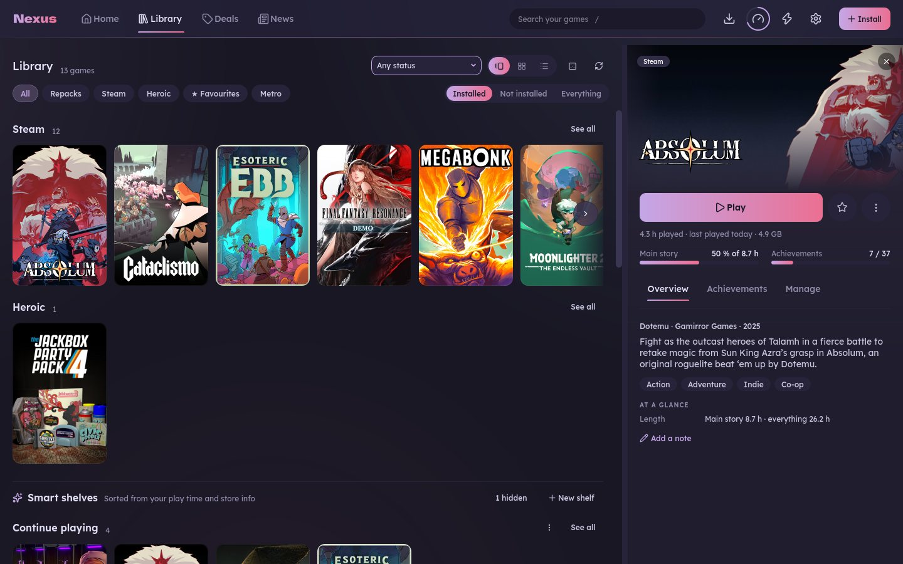
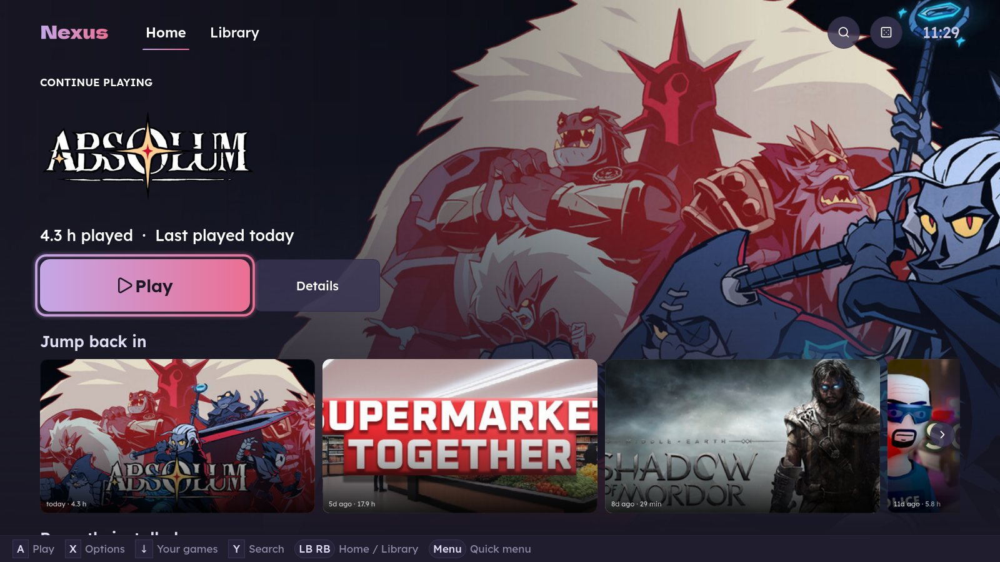
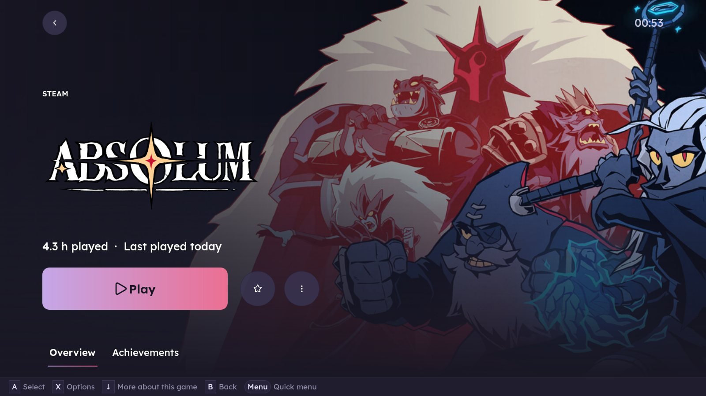
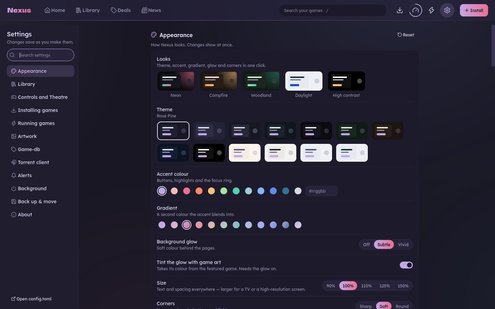

# Nexus

One launcher for all your PC games. Nexus puts your Steam and Epic games (and on Linux your
Heroic games) in one library, installs games from their Windows setup files, and keeps
everything tidy: artwork, play time, saves, disk space. It has a TV-friendly Theatre mode
for playing from the couch with a controller.

It runs on **Linux** (the main platform) and **Windows** (a newer edition, called
*nexus-launcher* there). [Linux vs Windows](#linux-vs-windows) below says what each one has.


> Nexus is an unofficial hobby project, not affiliated with Valve, Epic, Heroic or any
> store. It never downloads games by itself. Only install software you are allowed to use.
> MIT licensed, see [LICENSE](LICENSE).

## Features

### One library

Your Steam, Epic and repack games side by side (Heroic games too on Linux), as shelves, a
grid or a list. Filter by source, favourites or your own **collections** (*Couch co-op*,
*Short sessions*), and let **smart shelves** (Unfinished, Almost done, Never played, Short games,
Co-op and more) fill themselves from what Nexus knows about each game, and you can make
your own. A game you own twice shows
once. Games you own but haven't installed are there too, with an Install button.




- **A page for every game:** hero art and logo, Play, one line of play time and size, your
  progress through the story and the achievements, then tabs: Overview (description, genres,
  reviews, how long to beat, how it runs, your notes), Media (screenshots, trailers),
  Achievements and Manage (launch settings, files, logs).
- **Artwork that looks right:** covers, banners, heroes and logos from SteamGridDB, filled in
  quietly in the background. Pick another image for any game, Steam games included.
- **Home** starts with a *Continue playing* banner, then widgets you can move, resize or hide:
  Jump back in, Surprise me (it picks a game for you), News, Upcoming releases and more.

### Install and manage games

- **Install from a setup file:** point Nexus at a repack's `setup.exe` and it installs the
  game, finds the launcher, adds it to your library and fetches its artwork.
- **Storage cleanup:** one bar per drive, a clean-up list (stray prefixes, caches, old
  installers, old logs) that goes to the Trash first, and nothing that may hold saves is
  ever pre-selected.
- **Move, back up and uninstall safely:** games can move between drives, saves are backed up
  before an uninstall, and a running game is never uninstalled.
- **Health checks:** a checklist of what's ready and what's missing, with a fix for each.
- **Downloads:** shows and controls your Transmission or qBittorrent downloads, and tells you
  when a repack you have gets an update.

### Theatre mode, for the couch

Full screen, big tiles, readable from the sofa and driven by a controller (Xbox, PlayStation
and Switch pads). Start it with F11, the controller's Menu button or `nexus --theatre`.



- **Quick menu:** press Menu or Guide anywhere for a panel of big rows: a *Now playing* card
  with **Resume** and **Quit game**, your controllers and their battery, Exit Theatre.
- **Game page:** Play, favourite, Options, and cards for achievements, compatibility, news
  and trailers, all reachable with the D-pad.
- **On-screen keyboard** for search, a **screensaver** that shows your games' art or trailers
  when you're idle, and a Start/Guide map in the hint bar.
- **Colour and sound:** the background takes its colour from the game you're on, and soft
  menu sounds can be turned on in Theatre's settings (off by default).



### Stay informed

- **Deals, Upcoming and Backlog** (with a [Game-db](#game-db) server): wishlist sales sorted
  by how close they are to an all-time low, a countdown for unreleased games, and tonight's
  three picks for the time you have.
- **News:** gaming news and patch notes for your games, as a magazine.
- **Alerts:** a quiet background agent and tray icon tell you about sales, repack updates
  and new Proton builds; Discord status and phone notifications are optional.

### Make it yours

Dark and light themes, accent and gradient colours, background glow, corner style and a
90 to 150 % size for big screens. Changes save as you make them.



## Linux vs Windows

Nexus is one codebase, and both builds share the library, game pages, Theatre mode, storage,
downloads, deals and alerts. They differ in how a game runs, because Windows games already
run natively on Windows and need a compatibility layer on Linux.

| | Linux | Windows |
|---|:---:|:---:|
| One library for Steam and Epic games, with artwork, play time and achievements | ✓ (Epic through Heroic) | ✓ |
| Install a game from its `setup.exe` | ✓ (runs under Proton) | ✓ (runs natively) |
| Smart shelves, collections, game pages, Home widgets | ✓ | ✓ |
| Theatre mode and controller support | ✓ | ✓ |
| Now playing: Resume and Quit game | ✓ | ✓ |
| Storage cleanup, health checks, move and back up games | ✓ | ✓ |
| Save backup around uninstall | ✓ | ✓ (from the Ludusavi manifest) |
| Torrent client control (Transmission, qBittorrent) | ✓ | ✓ |
| Deals, Upcoming, Backlog (needs a [Game-db](#game-db) server) | ✓ | ✓ |
| Background alerts, tray icon, Discord status | ✓ | ✓ |
| Runs in the background | systemd user service | tray, started with Windows |
| App-menu entries | `.desktop` launchers | Start Menu shortcuts |
| Proton manager, ProtonDB, per-game Proton choice, umu | ✓ | not needed |
| Launch profiles: env vars, wrappers, per-game tuning | ✓ | — |
| Performance presets: gamescope, MangoHud, lsfg-vk | ✓ | — |
| protongen integration | ✓ | — |
| Heroic games and shortcuts | ✓ | — (skipped) |
| Sunshine game streaming | ✓ | — (planned) |
| Pause a running game, KDE Connect, system tuning tips | ✓ | — |
| Installer | Git checkout and a few commands | Installer or portable zip, no admin prompt |

A dash isn't a bug: those features only make sense on Linux, or aren't ported yet. The
Windows details are in [docs/WINDOWS.md](docs/WINDOWS.md#not-available-on-windows).

## Install

### Windows

Download the latest installer from the
[Releases page](https://github.com/cyberpunk89/nexus-launcher/releases)
(`nexus-launcher-Setup-<version>.exe`, Windows 10 or 11, 64-bit). It installs just for you,
with no admin prompt. A portable zip is there too.

The build isn't code-signed, so SmartScreen may warn you the first time: click
**More info → Run anyway**. [docs/WINDOWS.md](docs/WINDOWS.md) covers the rest: checking
the download, antivirus, torrent client setup and what isn't available on Windows.

### Linux

You need Python 3.11+ and PyQt6. `umu-launcher` is recommended for running Windows
installers.

```bash
git clone https://github.com/cyberpunk89/nexus-launcher.git ~/nexus-launcher
cd ~/nexus-launcher

# Arch / CachyOS / Manjaro (Fedora: dnf install python3-pyqt6 python3-vdf umu-launcher)
sudo pacman -S --needed python-pyqt6 python-vdf umu-launcher

# Put nexus and nexus-cli on your PATH (symlinks, so a git pull updates them)
mkdir -p ~/.local/bin
ln -sfn "$PWD/bin/nexus" "$PWD/bin/nexus-cli" ~/.local/bin/

nexus-cli --proton-install latest   # the newest GE-Proton, checksum-verified
nexus-cli --doctor                  # what's ready, what's missing, how to fix it
nexus --install-desktop             # app-menu entry and icon
nexus
```

Debian/Ubuntu, the Steam Deck and other setups are covered in
[docs/LINUX.md](docs/LINUX.md#quick-start).

## First run

A short setup walks you through what Nexus found on your machine (Steam, Epic or Heroic,
your torrent client), where games should go, and the look. Everything can be changed later
in Settings. For cover art, add a free [SteamGridDB](https://www.steamgriddb.com/profile/preferences/api)
API key there.

Settings live in `~/.config/nexus/config.toml` on Linux and `%APPDATA%\nexus-launcher` on
Windows. [config.example.toml](config.example.toml) lists every option.

## Game-db

The Deals page reads your Steam wishlist deals, upcoming releases and backlog from a
**Game-db** server. It's optional and self-hosted: Nexus has no built-in server. To use it,
enter your server's address and a desktop app token in Settings → Game-db.

## Documentation

- [docs/LINUX.md](docs/LINUX.md): the full Linux guide, with every page, the command line
  (`nexus-cli`), the integrations and the code layout.
- [docs/WINDOWS.md](docs/WINDOWS.md): the Windows guide.

## Development

Nexus is two programs on one codebase: `bin/nexus` is the PyQt6 app (`nexus/gui/`) and
`bin/nexus-cli` does the work (`nexus/cli/`, Python stdlib only). The app never blocks:
it asks the CLI for JSON in the background and runs every change as a queued job. Code that
differs by OS lives in `nexus/platform/`, and `nexus/features.py` says what each OS has.

```bash
python3 -m unittest discover -s tests
```

The tests need no network and never touch your real home folder. CI runs them on Ubuntu
and Windows for every push. Bug reports and pull requests are welcome.

<sub>Screenshots are of the Linux build with the default theme; the Windows build looks the
same apart from the Linux-only pages and options.</sub>
