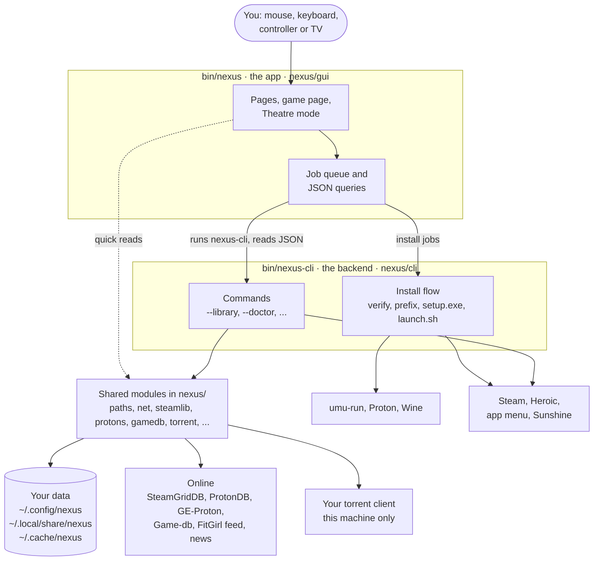

# Nexus on Linux: the full guide

Everything about the Linux app in detail: setup, every page, the CLI, integrations,
config and the code layout. For a short overview, see the [README](../README.md); for
Windows, see [WINDOWS.md](WINDOWS.md).

## Quick start

Developed on Arch / CachyOS with niri; other distros and desktops should work (everything
distro- or compositor-specific is optional) but are less tested — bug reports welcome.

**1. Get the code**

```bash
git clone https://github.com/cyberpunk89/nexus-launcher.git ~/nexus-launcher
cd ~/nexus-launcher
```

**2. Install the dependencies** (Python 3.11+, PyQt6; `vdf` for Steam shortcuts; `umu-launcher`
is the recommended way to run Windows installers)

```bash
# Arch / CachyOS / Manjaro
sudo pacman -S --needed python-pyqt6 python-vdf umu-launcher
```

```bash
# Fedora
sudo dnf install python3-pyqt6 python3-vdf umu-launcher
```

```bash
# Debian / Ubuntu (24.04+); umu-launcher: the .deb from github.com/Open-Wine-Components/umu-launcher/releases
sudo apt install python3-pyqt6 python3-vdf
```

```bash
# Steam Deck / anything without distro packages: a private venv
python3 -m venv ~/.local/share/nexus-venv
~/.local/share/nexus-venv/bin/pip install -r requirements.txt
```

**3. Put `nexus` and `nexus-cli` on your PATH** (symlinks, so a `git pull` updates them)

```bash
mkdir -p ~/.local/bin
ln -sfn "$PWD/bin/nexus" "$PWD/bin/nexus-cli" ~/.local/bin/
```

With the venv from the Steam Deck step, run `~/.local/share/nexus-venv/bin/python bin/nexus`
instead (or point the scripts' first line at that Python).

**4. Install a Proton build, check the setup, start the app**

```bash
nexus-cli --proton-install latest   # newest GE-Proton, checksum-verified
nexus-cli --doctor                  # what's ready, what's missing, how to fix it
nexus --install-desktop             # app-menu entry + icon
nexus
```

Optional: copy [`config.example.toml`](../config.example.toml) to `~/.config/nexus/config.toml`
for a SteamGridDB key (cover art), install folders, torrent client and so on — or set them
in the app's Settings page.

### Requirements

| | What | Needed for |
|---|---|---|
| **Required** | Linux (any distro; [Windows edition](WINDOWS.md) is separate) | everything |
| | Python 3.11+ | everything |
| | PyQt6 | the app (`nexus`); `nexus-cli` is stdlib-only |
| | a runner: `umu-run` + a Proton build (recommended), or Proton alone, or system `wine` | installing and playing repacks |
| Optional | `vdf` (python-vdf) | Steam shortcuts, Steam library details |
| | SDL2 | game controllers |
| | PyQt6 QtMultimedia | trailers in Theatre mode |
| | Steam, Heroic | showing and launching their games |
| | `winetricks`, `gamescope`, `mangohud`, `gamemoderun`, `lsfg-vk` | per-game tuning |
| | `clamav` | *Scan with ClamAV* on the Install page |
| | Transmission or qBittorrent (remote access on) | torrent hand-off |
| | niri, Sunshine, KDE Connect, protongen, scx / LACT, Game-db | the integrations described below |

## How it fits together

Two programs, one codebase. **`bin/nexus`** is the window you use; **`bin/nexus-cli`** does
the work. The app never blocks: every read is a background `nexus-cli … --json` query and
every change is a queued job, so an install, a Proton download or a slow Steam scan never
freezes the window. Both import the shared modules in `nexus/`.



### Components

- **`bin/nexus-cli`** — the backend. Installs a repack's `setup.exe` under **umu-run +
  Proton** into `~/Games/FitGirl/`, keeps the game registry, `launch.sh`, Steam shortcut,
  Heroic entry and desktop entry in sync, and serves every GUI view as JSON (`--library`,
  `--protons`, `--cleanup-scan`, `--doctor`, `--news`, `--gamedb`, …). Python 3.11+ stdlib
  (`python-vdf` for the Steam bits). The code is the `nexus/cli/` package.
- **`bin/nexus`** — the PyQt6 app, the `nexus/gui/` package.
- **`nexus/`** — shared modules: `paths` (all locations + the one-time migration), `net`
  (the one HTTP client, plus `write_atomic` / `save_json` / `cached_json`), `steamlib`
  (installed Steam/Heroic games, read-only), `protons` (GE-Proton releases, verified
  install), `cleanup` (candidate rules, Trash), `tips` (GPU detection, protongen recipes,
  performance checks), `protondb`, `compat`, `storeinfo`, `hltb`, `news`, `gamedb` (Game-db
  client + private cache), `torrent`, `repackfeed` / `repackindex` (the FitGirl feed and
  site index), `achievements` / `emuach`, `history`, `session`, `presence`, `notify`,
  `safety` and `inno` (the pre-install repack check), `winfocus`, `gamepad`, `icons`.

### Code layout

Both packages are split one module per area. A module imports the shared base layers at
the top and its siblings at the bottom (every use is inside a function), so the parts can
call each other without import cycles. `nexus.cli.<name>` and `nexus.gui.<name>` still
reach every name: each package's `__init__` re-exports them.

```mermaid
flowchart TB
  subgraph g["nexus/gui · the app"]
    direction TB
    g1["Base: common, theme, fmt"] --> g2["Building blocks: widgets, jobs, art, tiles, prefs, gameinfo, actions"]
    g2 --> g3["Pages: library, dashboard, details, storage, protonpage, newspage, deals, downloads, artpicker, system, settings, install, theatre, input"]
    g3 --> g4["window: MainWindow + mixins win_library, win_nav, win_controller, win_play, win_downloads, win_actions; topbar, tray"]
    g4 --> g5["app: icon, desktop entry, single instance, main()"]
  end
  subgraph c["nexus/cli · the backend"]
    direction TB
    c1["Base: common (paths, logger, atomic writes, run)"] --> c2["Core: repack, runner, config, registry, sgdb, launchprofile"]
    c2 --> c3["Launchers: steam, heroic, desktop, sunshine"]
    c3 --> c4["Commands: manage, running, apply, protoncmds, downloads, info, gamecmds, doctor, install, importgame, move, snapshots, agent"]
    c4 --> c5["entry: build_parser(), the COMMANDS table, main()"]
  end
```



Where to look:

| To… | Go to |
|---|---|
| add a CLI command | `nexus/cli/entry.py`: an option in `build_parser()`, a row in `COMMANDS` (the first flag given wins) |
| change the install steps | `cmd_install` in `nexus/cli/install.py` |
| save a file | `net.write_atomic` (or `net.save_json` for a cache): never a half-written file |
| cache a web lookup | `net.cached_json` (per-game JSON) or `net.cached` (a URL); both remember failures |
| ask the CLI from the app | `cli_json` / `in_thread` in `nexus/gui/jobs.py`: never on the GUI thread |
| change what the window does | the `nexus/gui/win_*.py` mixin for that area |
| log from the CLI | `log.print(...)`; swap the target with `use_logger()`, never rebind `log` |
| do something while no window is open | a `task_*` method of `Agent` in `nexus/cli/agent.py`; hand results to a window with `nexus.instance.forward` |
| alert once | `nexus/alerts.py`: an item with a stable `key`, then `fresh()` and `deliver()` |
| create or delete a game's folder | `make_game_dir` / `remove_game_dir` in `nexus/cli/snapshots.py` (a subvolume on btrfs) |

The look follows protongen's design system (Rosé Pine dark): token-driven colour/space/type,
portrait tiles with a caption gradient and pill badges, one accent colour.

## The app

One window with a top bar — **Home · Library · Deals · News** as tabs, then search, round
icons for **System · Proton · Settings** (with badges — System shows running jobs, else
health problems, and draws a disk-usage ring) and **＋ Install**. No pop-up dialogs beyond file pickers and "quit while
jobs run?". Under 1000 px wide the tabs fold to icons.

- **Home** — a cinematic hero (up to five featured games: playing now, recently played, a
  favourite, an update, something new) with the game's logo, a few facts and Play; it
  cross-fades every few seconds unless you're pointing at it, and the window's glow takes on
  the art's colour. Under it, a **dashboard** of widgets: Jump back in (wide banners),
  **Surprise me** (picks a game for you — never-played ones and ones you haven't touched in
  a month come up more, favourites a little more; *Pick again* in the toast),
  **System** (four tiles — jobs, disk free, health, Proton — each opening its page; wide adds
  the one thing that needs you, such as a GE-Proton update with Install), News (with
  thumbnails), Recently installed (never-played games get a **New** pill), Wishlist deals,
  **Upcoming** (unreleased wishlist games, soonest first, with the cheapest current price —
  keyshops included — and a Pre-order tag), Favourites, Collections (a row per collection),
  Updates ready, and hidden by default
  Play time, Achievements (recent unlocks, games closest to 100%) and In your library.
  **Customise** lets you move (←↑↓→), resize
  (small/wide/full) and hide widgets — all buttons, so it works with a controller; the
  layout is saved in `~/.config/nexus/library.json` (older layouts are migrated: the old
  Activity/Storage/Health/Proton cards become System in the same place).
- **Library** — your Steam, Heroic and repack games together, as **Shelves** (one row per
  source), a **Grid** with a tile-size slider, or a dense **List**. Source chips
  (All · Repacks · Steam · Heroic · ★), a status filter, sort; typing in the top-bar search
  jumps here. Rows page sideways with ‹ › buttons instead of scrollbars. The 🎲 button picks
  a game from whatever the Library is showing.
  - **Collections** — your own groups of games (*Couch co-op*, *Short sessions*…). Add a
    game from its ⋮ menu (*Collections ▸*, or the controller sheet) — *New collection…*
    names one (with a controller, on the on-screen keyboard). Each collection gets a chip
    after ★; right-click it (or X on a pad) to rename or delete it. Theatre shows a row per
    collection. Kept in `~/.config/nexus/library.json`.
  - **Installed · Not installed · Everything** — the rest of your library too: Steam games
    you own (from [Game-db](#game-db-integration)'s cached library — Steam keeps no readable
    ownership list) and your Epic / GOG / Amazon games (from Heroic's store caches). They show
    greyed art with a download mark; **Install** opens Steam's install dialog (or Heroic's
    "install it?" prompt) and Nexus follows the download (*Installing 42%* on the tile and the
    game page) and says when it's ready. Home, featured games and Storage stay about installed
    games; there's an optional *In your library* dashboard row. Off in Settings if you don't
    want them.
  - A tile is just the game's art — no badges. The title fades in on hover with a **⋮** button
    (⋮ and right-click open the same menu); a green dot marks the game being played.
    A click (or Enter / A) opens the game's page, where Play is.
  - **Details panel** (click a tile, from Home or Library): hero art, the game's status as
    chips (source, ProtonDB tier, update, favourite, launch options), Play, play time /
    last played / size.
    Below them, five sections: **Launch** (repacks: Runtime, Display, Frame rate, Fixes and
    overlay, suggested fixes for your GPU, Advanced, with one Apply bar; Steam/Heroic games
    get only the suggestions and protongen's saved options to copy), **Game and files**
    (name, exe, folder, Steam/Heroic, snapshots), **Troubleshoot** (logs, benchmarks,
    *Explain with local AI* when protongen's AI coach is on), **About** (store info,
    Game-db, compatibility with the ProtonDB tier, achievements) and **Notes**. Wine tools
    and the rest live in ⋮. Steam games get Steam shortcuts (page, properties, verify,
    uninstall) and *Tune in protongen*.
- **System** (Ctrl+5) — Activity, Play history, Storage and Health as sections of one page:
  - **Activity** — every job as a card (step, progress, elapsed, Cancel, its own log), a strip
    under the library and a ring on the tile; toasts when done (and `notify-send` if the window
    isn't focused). The raw console is the **Debug log** (Ctrl+`).
  - **Play history** — this year in review (hours, sessions, games, best streak, longest
    session, busiest day), hours per week for the last 12 weeks, and your most played. Sessions
    are recorded from now on (`~/.local/share/nexus/sessions.jsonl`): repacks by their launch
    tracker, Steam and Heroic games while Nexus is open. `nexus-cli --history`.
  - **Storage** — one bar per drive (every game as a segment), a table, and **Clean up**:
    stray Steam prefixes (all libraries), shader caches of removed games, Mesa cache,
    repacks you've already installed, old `--force` installs, old logs and save backups,
    leftovers of removed games. Items go to the **Trash** (recoverable) or, if you choose,
    are deleted forever; stray prefixes go to **quarantine** first and can be restored.
    Anything that may hold saves is never pre-selected.
  - **Health** — the doctor as a checklist with fix buttons, including a **Performance** group
    (sched-ext scheduler, power profile, `vm.max_map_count`, open-file limit, ntsync, gaming
    tools, hybrid GPUs) that suggests commands to copy — Nexus never changes system settings.
- **The game page** also has **About** — the Steam store's blurb, genres, review summary,
  Metacritic, **how long to beat** (HowLongToBeat, for every game — Game-db's figure when it has
  one), trailers that play inside the window (Esc closes; needs `qt6-multimedia-ffmpeg`) and
  **more like this** (games you own link to their page) — and **Notes**, saved as you type.
- **Theatre screensaver**: after a few idle minutes in Theatre (Settings → Controls), your
  games take turns full screen — hero art drifting slowly, or the store trailer, muted. Any
  button ends it; A opens the game on screen.
  `nexus-cli --store-info <game>`. HowLongToBeat has no public API: Nexus asks its search
  the way its own page does, once per title, cached for a month.
- **One tile per game**: a game you have as a repack *and* on Steam or Heroic shows once
  (installed first, then repack › Steam › Heroic); its page says "Also in Steam". Settings →
  Controls → *A game in several stores* turns this off. Steam and Heroic games can be given
  your own name (⋮ → *Rename in library…*; only Nexus shows it).
- **Proton** — installed builds and which games (Nexus, Steam, Heroic) use each; install any
  GE-Proton release (sha512-verified, right CPU architecture) into Steam's
  `compatibilitytools.d`; move games from one build to another; remove unused builds;
  proton-cachyos shows its pacman version.
- **News** (experimental) — GamingOnLinux, Boiling Steam, Proton releases and patch notes for
  your installed Steam games, as a magazine: a featured story, then a grid of picture cards
  (the feed's own image, else the game's banner; a coloured placeholder otherwise), with
  chips per source. A card opens a **reader** beside the grid (picture, summary, Read the
  article, Copy link, Show game; ⌃/⌄ walk the stories, Esc closes). Pictures are fetched
  only when their card nears the screen, and cards are built 36 at a time. Add your own
  https RSS/Atom feeds under **Manage feeds**. Can be hidden in Settings.
- **Deals** (with [Game-db](#game-db-integration)) — three tabs. **Deals**: your Steam
  wishlist, on-sale games first (closest to their all-time low), with price, discount,
  all-time-low / near-low pills, best shop, bundle and ProtonDB tier; filter On sale ·
  All-time low · All wishlist. **Upcoming**: unreleased wishlist games with a countdown (or
  Steam's "Q2 2027"). **Backlog**: beaten / in progress / not started / hours left, and
  tonight's three picks per time budget (Play if installed, else Install in Steam). Cards
  are focusable: Enter/A opens the best deal, Menu/X lists every link (deal, GG.deals,
  Steam, Game-db, copy). The Deals tab's badge counts games on sale, and the details panel's
  About section shows a Game-db line for any game it knows (wishlist price, or HLTB time and
  how far through you are). Up to 200 cards show at once; the line above them says how many
  matched, and search or the filters reach the rest. A refresh that fails keeps what is on
  screen and says why in the banner.
- **Artwork** — *Change artwork…* (game menu, details panel) opens a page of SteamGridDB
  images for that game — cover, banner, hero, logo, icon — for **any** game, Steam and
  Heroic included. Pick one and it's used everywhere (and on a repack's Steam shortcut);
  *Reset to default* undoes it. If SteamGridDB matched the wrong game, *Wrong game?* searches
  it by name and pins the right one (CLI: `--sgdb-search`, `--set-sgdb`); art from the old
  match is cleared. Steam's own files are never touched. Missing heroes, logos
  and banners are filled in quietly once a day (or *Fetch extra artwork* in Settings).
  Needs a SteamGridDB API key.
- **Appearance** (Settings) — five dark themes (Rosé Pine, Moon, Mocha, Slate, Midnight) and
  two light ones (Dawn, Paper — the accent deepens to stay readable, text over art stays on a
  dark scrim), a **Size** (90–150 %: type and spacing everywhere, Theatre on top of its own),
  an accent colour (presets or any hex), the gradient partner for buttons and highlights (or
  solid), background glow (off / subtle / vivid, optionally tinted by the featured game's
  art) and corner roundness. Applied live and saved with the rest of `library.json`.
- When Steam must be closed (it rewrites its files on exit), a banner waits and carries on by
  itself once Steam quits. Installs never wait for it: the game installs straight away and
  only its Steam shortcut waits (then **Start Steam**).
- **Installing a repack** — FitGirl's installer runs **silently** by default (no setup
  window; its default languages and optional parts) into the game's own `C:\Games\<slug>`,
  with how much it has written and how fast. Untick *Install without the setup window* (or
  Settings) to click through it yourself. Afterwards a toast says which `.exe` it picked,
  with **Change game file** (the runners-up, one click) and **Trash repack**. A cancelled or
  failed install stays in the library as **Resume install** / *Discard unfinished install*;
  a failed one offers **Retry**, **Verify & retry**, or — when the silent installer didn't
  suit the repack — **Retry with setup window**.
- **Downloads** — Nexus watches your repack folders (Settings: *Look for repacks in*, *Also
  look in*) and, once a download has finished and stopped growing, says "*X* is ready to
  install" (**Install** with your defaults, or **Options…**). The Install page lists every
  folder found (still downloading, already installed, new release) with **Install all**.
  A new release of a game you installed (its MD5 list differs from the one recorded at
  install — FitGirl repacks carry no version) shows under **Updates ready** with **Install
  update**, which installs over the old one; saves and settings stay.

**Keyboard and controller.** Arrow keys move focus spatially everywhere (to the nearest
control in that direction), shown by one soft ring around the focused control (it hides as
soon as you use the mouse), Enter on a game opens its page with **Play** focused, Esc steps
back (details → game → close → library), the Menu key opens a game's menu.

**Mouse, keyboard and controller each get their own interactions.** Nexus tracks which one
you're using. The mouse gets hover buttons and the right-click menu; keys get the focus ring
and the same menu; a controller gets the ring, the button hint bar and the **options sheet** —
a panel of big rows (D-pad, A, B closes) — and never a desktop right-click menu. Theatre mode
always uses the sheet.

A game controller does the same, through SDL (Xbox, PlayStation, Switch Pro, Steam
Deck/Controller via Steam, most generic pads; no extra Python packages):

| Button | Does |
|---|---|
| D-pad / left stick | move focus (with repeat) |
| A / ✕ | select — on a game: open its page, again: play |
| B / ○ | back |
| X / □ | the game's options (a controller sheet, not the desktop menu) |
| Y / △ | search — in Theatre, Nexus's own on-screen keyboard; on the desktop, Steam's when Steam is running |
| LB / RB | previous / next tab (Home · Library · Deals · News) |
| LT / RT, right stick | scroll |
| View / Share | switch Shelves · Grid · List; in Theatre's Library: **Sort & filter** |
| Menu / Options, or Guide (Xbox / PS button) | on the desktop: **Theatre mode**; in Theatre: the **quick menu** |
| F11 | **Theatre mode** on / off |

**Theatre mode** is Nexus for the TV: full screen, a big hero, rows of large tiles (plus
*Ready to install* for games you own), a full Library grid, a clock, bigger type and focus
glow, and the pointer hidden until the mouse moves. LB/RB switch between the tabs (Home, Library, and Discover and Downloads while their
features are on); Library has a chip, or View, for **Sort & filter** (A to Z, recently played,
most played, recently added, or grouped by collection; installed, not installed or everything),
and Nexus remembers your choice. A opens a
game, B goes back (never out of Theatre), F11 leaves. Start it directly with `nexus --theatre`
or the desktop entry's *Theatre mode (TV)* action.

The **quick menu** (Start or Guide on a pad, F10 or a remote's Home key) opens on the left from
any Theatre screen: the time and date, your controllers and their battery, **Exit Theatre**
and **Quit Nexus** (which asks first only while a job is running). Below them, when your
system allows it (logind), **Sleep**, **Restart PC** and **Shut down**: Sleep acts at once, the
other two ask first. B closes it.

When a game you played for a minute or more closes while Theatre is on, its page opens with
**Session ended**: this session's length, your total, and the achievements you unlocked, with
**Play again** and **Back to Home** (B also goes Home).

The **Downloads** tab lists the repacks Nexus is downloading, installs running or waiting, and
Steam and Heroic downloads, grouped *Ready to play*, *In progress* and *Up next* (A does a row's
main action, X opens its options: pause, stop, move up or down in the install queue). When a
download or install finishes, a banner under the clock says so for ten seconds instead of a
toast; View jumps to the game or the row.

The **Discover** tab has shelves of news for your games, sales from your Game-db wishlist,
coming-soon games and the latest news. A opens a story in a reader (LB/RB step through the
shelf, X opens the article in the browser or copies its link) or a deal's options (open in
Steam, grab the FitGirl repack, show the game). Without Game-db a card says so and X hides it.

**Theatre search** (Y, or the search button by the clock) is full screen: the query, an
on-screen keyboard driven with the D-pad (A types, X deletes, Y adds a space, B closes) and
the matching games as big tiles — installed first, then games you own. A real keyboard
types straight in. B from a game you opened goes back to the search.

The **Theatre game page** has Play / Favourite / **Options** (X), and under them cards you can
move to with the D-pad: **Stats** (play time, last played, size, install date, HowLongToBeat
progress), **Compatibility** (ProtonDB tier and trend, the Proton it plays with, launch
options, tuning suggestions for your GPU), **Achievements** (Steam games: how many, and
the full list), **Game-db** (how far through, or wishlist price)
and **News** for that game. A on a card opens its longer version; B closes it. Options that
open a desktop page (game settings, log, artwork, uninstall) say *leaves Theatre*; folder,
Wine tools and protongen aren't offered on the TV.

**One window.** Launching `nexus` again — the app menu, a session manager restoring windows,
Sunshine — brings the running window forward instead of opening a second one (`--theatre`
switches it to Theatre). `nexus --leave-theatre` returns a running Nexus to the desktop and
never starts one; it's meant for a streaming app's "undo" command.

A hint bar shows what the buttons do right now. Nexus only reads controllers while its
window is focused — a game you launch gets the controller to itself — and reads them through
SDL with its HIDAPI drivers off, so it never talks to the device (no lightbar/LED/rumble
changes). If Steam's
*Desktop* controller layout is also turning the pad into key presses, duplicates are
filtered out. `NEXUS_NO_GAMEPAD=1` turns controller input off.

**Playing now.** Play switches to **Starting…** at once and to **Playing** when the game is
really running (Nexus checks every 2 s while a game starts); running games get a green dot
and take over the Home banner, and Play won't launch a second copy. Under **niri**, Nexus
hands focus to the game's window as soon as it opens (Steam games are matched by their
`steam_app_<id>` window) and takes it back when the game closes; elsewhere, Theatre mode
steps aside (minimises) once the game is running.

**Game page.** Click a game (or A on a controller) for its page: Play, a row of quick
actions (favourite, Steam page / properties / protongen, launch settings, log, folder,
artwork), a stats grid (play time, last played, size, install date, Proton, ProtonDB, and for
Steam games **achievements**, listed under About, newest unlock first; hidden ones stay
hidden until unlocked), a "how far through" bar when Game-db knows the time to beat, and
five collapsed sections: Launch, Game and files, Troubleshoot, About and Notes. In Launch,
nothing changes until you press **Apply**: the bar says how many changes wait, and
*Discard* puts them back. Switches whose tool isn't installed say so. Wine tools and the
rest live in ⋮.

Shortcuts: **Ctrl+K command palette** (games, pages, Settings sections and commands, fuzzy —
"hk", "move noc"; Tab on a game lists its actions) · `/` search · Esc back · Ctrl+N install · Ctrl+R refresh (also retries art that
failed to download) · Ctrl+D surprise me · F11 Theatre mode ·
Ctrl+1–4 tabs · Ctrl+5 System (Activity) · Ctrl+, Settings · Ctrl+` debug log.
`NEXUS_NO_MOTION=1` turns animations off.

**niri / tiling compositors** (optional). The Wayland app-id is `nexus`, and the top bar folds its tabs
to icons in a narrow (half-width) column. niri floats any window with a parent or a fixed size —
which is why the FitGirl *installer* window (fixed-size, run through Wine) opens floating.
To make it easier to reach, add a rule like this (check the real app-id with
`niri msg windows` while the installer is open; under Wine it is usually the exe name):

```kdl
window-rule {
    match app-id=r#"(?i)^(setup|setup\.tmp|setup\.exe)$"#
    open-floating true
    open-focused true
    default-floating-position x=0 y=0 relative-to="top"
}
```

## protongen integration (optional)

protongen is the author's separate Proton tuning app; without it these features simply
don't show. Nexus reads protongen's files and never writes them (protongen rewrites `state.toml` as a
whole):

- protongen's remembered tuning is shown for every game — repacks can **pull** it into their
  launch options (applied to Steam, Heroic and `launch.sh`), Steam/Heroic games get it to
  **copy** into their launcher.
- protongen's **default profile** (Settings → *Save as default profile*) can set a repack up
  in one step: *Use my protongen defaults* on the Install page (on whenever a default
  exists), or *Use protongen defaults* in a game's ⋮ menu / Launch → Advanced. It sets the
  launch options and the Proton, applied to Steam, Heroic and `launch.sh`.
- protongen's recipe catalog (`~/.config/protongen/recipes.toml`, else a bundled copy in
  `nexus/data/`) becomes GPU- and ProtonDB-aware suggestions.
- *Tune in protongen* runs `protongen --game <id>` (Steam appid, or protongen's hash of the
  Heroic app name); a protongen without that flag just opens normally.
- GE-Proton builds Nexus installs land where protongen looks, and protongen's dismissed
  updates are shown on the Proton page.
- *Explain with local AI* uses protongen's configured local model — loopback endpoints only.

## Game-db integration (optional)

Game-db ("The Backlog") is a separate, private web app — you need an account on a Game-db
instance to use this; without one the Deals page stays hidden. It syncs your Steam wishlist and library and prices them via IsThereAnyDeal and GG.deals.
Nexus reads one read-only endpoint, `GET /api/nexus/v1/summary`, with a personal token:

1. On Game-db, open **Account → Desktop app tokens**, create a token (`gdb_…`) and copy it —
   it's shown once and only its hash is stored. Revoke it there any time.
2. In Nexus, **Settings → Game-db**: tick *Show the Deals page*, enter your Game-db
   server's address (there is no default) and paste the token. Or set `NEXUS_GAMEDB_URL`
   and `NEXUS_GAMEDB_TOKEN` in the environment.

Details:

- The response is cached for 45 minutes in `~/.cache/nexus/gamedb/` (mode 0600 — it's
  personal data); Refresh / `--refresh` bypasses it. Offline or with a revoked token the
  last copy is shown with a banner; a 429 is respected until its `Retry-After`.
- Only `https://` is accepted (plain `http://` only for `localhost` while developing
  Game-db), redirects are refused so the token can't be forwarded elsewhere, and the token
  is never put on a command line or in an error message.
- The details panel's Game-db line and `--gamedb-lookup` read the cache only — no network
  on Library load. Opening Deals (or the first Library load, once) refreshes it.
- Its `library[]` is also where Nexus learns which Steam games you own but haven't
  installed: `--library --owned --json` adds them (and Heroic's not-installed Epic / GOG /
  Amazon games) with `installed: false` and an `install_url`; games Steam or Heroic are
  downloading get `installing: {done, total, paused}`. Cache only, never the network.
- **Game details** (a Game-db with API v2): ProtonDB tier, play length (HowLongToBeat's,
  or IGDB's when HLTB has none, labelled as such), Steam reviews and release status (Early
  Access and the like) for your own library and wishlist are kept in
  `~/.cache/nexus/gamedb/games.json` (0600). The agent (on Windows, the window when no
  agent runs) syncs it at most every 6 h, only what changed since the last sync. A game
  page for one of those games then sends nothing to ProtonDB or HowLongToBeat while
  Game-db's copy is fresh; for any other game, or with Game-db off, unreachable or too
  old to offer it (Nexus asks `v2/meta` once a day), Nexus fetches them itself as before.
  Settings → Game-db → Game details from Game-db switches it off. Every Game-db request
  says which Nexus asks (`X-Nexus-Client: nexus/<version> <os>`) and from which PC
  (`X-Nexus-Device`: Settings → This PC's name, default the hostname, never a path);
  Game-db shows both next to the token on its account page.
- **Play sessions** (off by default; a Game-db that offers `sessions` and a token made with
  "Upload play sessions"): Settings → Game-db → Upload play sessions sends what Nexus
  records in `sessions.jsonl` (store, store id, title, start, end, minutes) on the agent's
  deals tick (on Windows, the window's). Steam games go as their appid, Heroic's Epic, GOG
  and Amazon games as their app name. Repacks and other games stay on the PC unless
  "Include games not from a store" is on too; then they go as a cleaned title only, never a
  folder, store id or repack name. Each session has an id, so a retried upload adds nothing
  twice; `~/.cache/nexus/gamedb/sessions-upload.json` (0600) remembers how far the file was
  sent. A read-only token gets a hint in Settings instead of uploads.
  `--gamedb-delete-sessions [--json]` deletes every session Nexus sent to this account.
- **Your Heroic library** (a Game-db that offers `library` and a token made with "Send my
  other-store library"): once a day the agent sends the Epic, GOG and Amazon games Heroic
  says you own (store, app name, title). Game-db finds them on IGDB, and their game page
  in Nexus then shows studio, genres, description and play length too. Settings → Game-db →
  Send my Heroic library switches it off.
- CLI: `--gamedb` (everything), `--deals`, `--upcoming`, `--backlog [--time
  lt1h|1to3|3plus|long]`, each with `--json`; `--gamedb-lookup APPID…`; `--gamedb-sync
  [--refresh] [--json]` (game details now, then the uploads that are switched on; normally
  the agent's job); `--gamedb-delete-sessions`. `--doctor` reports
  the sync state of both, a config.toml that holds the token but isn't 0600, and a Steam
  account mismatch between Game-db and Nexus.

## Finding a repack to install

```bash
nexus-cli --scan               # look in the repack folders (default ~/Downloads)
nexus-cli --scan --scan-dir ~/torrents --json
```

A repack folder is detected by the same signal the installer itself needs — a
`setup.exe` directly inside it — so a candidate is always actually installable.
Each result says whether it's already installed, whether it's still downloading
(`complete`: partial files, or a non-optional `.bin` from the MD5 list missing),
and `update_for` when it's a different release of an installed game. The name is
the installer's own title (its ProductName) when it has one, else the folder name
without `[FitGirl … Repack]`, `+ N DLCs` and the like; a slug already in the
library always wins, so updates land on the same install.

```bash
nexus-cli "<repack>"                 # silent install into C:\Games\<slug>
nexus-cli "<repack>" --interactive   # click through FitGirl's setup window
nexus-cli "<repack>" --trash-repack  # repack to the Trash once installed
nexus-cli --discard-incomplete <slug>   # bin an unfinished install (never a library game)
```

Installs print `@nexus <event> <json>` lines for the GUI (`progress`,
`exe-candidates`, `retry-interactive`, `installed`); `--defer-steam`
leaves the Steam shortcut for a later `--steam <slug>` when Steam is running. An
unfinished install keeps a `.nexus-incomplete` marker (with the arguments to resume
it) in its folder.

## Runner backends

The installer picks a runner automatically, preferring the most reliable one available:

| backend  | what it uses                              | notes |
|----------|-------------------------------------------|-------|
| `umu`    | `umu-run` + GE-Proton (default when both present) | bootstraps the Steam Linux Runtime modern GE-Proton requires — most reliable for FitGirl setups |
| `proton` | raw `proton run` + GE-Proton              | works, but needs the matching Steam Runtime already present |
| `wine`   | system `wine` with `WINEPREFIX`           | last-resort fallback |

Override with `[runner] backend` in the config (see below). Games install into
`<install base>/<slug>/pfx/…`; the generated `launch.sh` uses the same runner so the
runtime bootstraps at play time too.

## Install-time behaviour worth knowing

- **`chattr +C` on the game directory.** Set while the directory is still empty, so files
  created inside inherit it. On a CoW filesystem (btrfs) this turns off copy-on-write and
  compression for that tree: game data is already compressed, so the default burns CPU on
  incompressible bytes and fragments the prefix's registry and save writes. Best-effort —
  silently skipped on filesystems that don't support it. Note it also disables btrfs
  checksums for those files; the repack's own MD5s still cover the source.
- **Parallel MD5 verification.** `--verify` hashes files concurrently (up to 6 at once).
  `hashlib` releases the GIL, so this scales with cores on what is usually the longest
  step you actually wait on.
- **`WINEDEBUG=-all` by default.** FitGirl installers spam Wine's `err+fixme` channels and
  that output is captured. `--debug` restores `warn,err,fixme` plus `PROTON_LOG=1`.
- **Disk-space check.** An early heads-up prints if free space at the install base is under
  1.5x the repack's own size, and a hard stop (re-checked on each installer retry, like the
  memory check) refuses to run `setup.exe` at all below 1x — extraction needs at least that
  much room. Bypass with `--skip-disk-check` (GUI: "Skip disk space safety check").
- **Already-installed warning.** Re-running against a slug that already has a prefix now
  asks before reusing it — handy for installing an update/DLC repack on top (`--yes`
  auto-confirms). `--force` starts from a fresh prefix instead: the old install is moved to
  `<slug>.old-<time>` next to it (saves included), never deleted.
  The GUI checks this before a job even starts, so a duplicate install is caught before
  spending any time on verify/prefix-init.
- **Cancelling a job.** The GUI's Cancel button sends the CLI process SIGTERM, which it
  traps to also stop whatever subprocess is currently running (umu-run/wine/winetricks) —
  not just the Python wrapper — falling back to SIGKILL if it doesn't exit promptly.
  Quitting Nexus while a job runs asks first, then waits (up to 6 s) for the jobs to stop
  the same way instead of killing them mid-write.
- **umu game id.** With the umu runner, `launch.sh` exports `GAMEID` from umu-database (or
  `umu-<steam appid>` when the Steam store has the exact title), so umu-protonfixes applies
  that game's fixes; `--show-launch` shows it. Unknown or offline: `umu-0` as before.
- **Games deleted by hand.** `nexus-cli --prune` lists registry entries whose files are
  gone; `--prune --yes` removes them with their Steam shortcut, Heroic entry, app-menu entry
  and launcher. A game on a drive that looks unmounted is never pruned. Health offers it.
- **Uninstall safety.** Every slug argument is checked (`--uninstall ..` is refused), and
  uninstall only deletes a game folder that is a direct, non-symlinked child of its install
  base. Save backups skip caches, logs and Start Menu shortcuts, and a backup or restore
  that can't copy a file says so (uninstall then stops before deleting anything).

## Launcher integration (Steam / Heroic)

Before Nexus rewrites a file another program owns (Steam's `shortcuts.vdf` and
`config.vdf`, Heroic's sideload library and per-game config, Sunshine's `apps.json`) it
keeps a copy beside it as `<name>.bak-<timestamp>`: one per operation, taken before its
first write, the newest five kept.

On install, the game is added to whatever launchers are enabled in `[integrations]`:

- **Steam** — a non-Steam shortcut pointing straight at the game `.exe`, with a Proton
  *forced* on it and `steamapps/compatdata/<appid>` symlinked to the installed prefix so
  Steam's Proton uses it (the same model as Heroic). Steam must be **closed** when writing
  shortcuts / config.vdf.

  That symlink is what keeps saves and registry with the game. Without it Steam builds its
  own prefix keyed to the shortcut's appid, and since the appid is `crc32(exe + name)`, a
  rename or a moved install silently points the game at an empty prefix. For the same reason
  the appid is now taken from `games.json` when one is already recorded, and only computed
  fresh for a new game.

  **Multiple Steam accounts:** shortcuts live per-account, under
  `userdata/<accountid>/`. The tool picks the account Steam last signed in as
  (from Steam's connection log), then `MostRecent`/`AutoLogin` in
  `loginusers.vdf`. If that guesses wrong, pin it — `steam_account` takes an
  accountid, a steamid64, a login name or a persona name:

  ```bash
  nexus-cli --list-steam-accounts   # who's on this machine, and who wins
  nexus-cli --steam-account mysteamlogin --steam <slug>   # one-off override
  ```

  ```toml
  [integrations]
  steam_account = "mysteamlogin"   # permanent pin
  ```
- **Heroic** — a sideloaded app pointing at the game `.exe`, with a per-game
  `GamesConfig` (Proton + prefix). Re-adding a game is idempotent (matched by
  executable) and never overwrites an existing per-game config or its artwork —
  only the Proton and, if the game has a launch profile, its env / wrappers / args.

Re-adding a Steam shortcut updates it in place: your collections, hidden flag, play time,
icon and launch options are kept. `shortcuts.vdf`, `config.vdf` and Heroic's library are
written atomically, a damaged one is left untouched rather than replaced, and only the last
5 timestamped `.bak` copies are kept.

Manage these after the fact (restart the launcher to see changes):

```bash
nexus-cli --steam <slug>          # add / repair Steam shortcut
nexus-cli --remove-steam <slug>
nexus-cli --heroic <slug>         # add to Heroic
nexus-cli --remove-heroic <slug>
nexus-cli --repair-launchers      # regenerate launch.sh for all games
nexus-cli --apply-launch <slug>   # re-apply a game's settings everywhere ('all' = every game)
nexus-cli --list                  # show steam / desktop / heroic status
nexus-cli --list-steam-accounts   # which Steam account shortcuts go to
```

`launch.sh` still exists, but only for launching *outside* Steam — the app-menu entry and
`nexus-cli --launch <slug>`.

**Sunshine** (streaming to Moonlight): `nexus-cli --sunshine <game>` adds or updates an
entry in `~/.config/sunshine/apps.json` (backed up first; never rewritten if it can't be
parsed) and `--remove-sunshine <game>` takes it out — also "In Sunshine" in a game's ⋮ menu.
A repack runs as `nexus-cli --launch <slug> --wait`, so the stream ends with the game; Steam
and Heroic games are handed to their launcher. Restart Sunshine afterwards for Moonlight to
see the change.

**Launch through Steam** (Launch → Runtime → *Start from: Steam*, then Apply, or `nexus-cli
--launch-via <slug> steam|nexus`): Play starts the repack's Steam shortcut, so it gets Steam
Input, the overlay, game recording and your Steam status. Nexus's own extras for a launch
(Discord, stay-awake, `[session]` tuning, achievement pop-ups) then don't run; play time is
still recorded while Nexus is open.

**Achievements for repacks**: the Steam emulator a repack ships (gbe_fork / Goldberg, CODEX,
RUNE, EMPRESS, OnlineFix, SKIDROW) writes its unlocks inside the prefix; Nexus reads them
(never writes) and matches them to the game's list — from Steam's cache if you own it, else
the public Steam Community page (cached a month). They show like Steam achievements (game
page, Theatre card, counts on the tile), and while a repack runs from Nexus each new unlock
pops up as a desktop notification with its icon. `nexus-cli --achievements <slug>`.

**Is this repack safe?** Picking a repack on the Install page looks it over first
(`nexus-cli --check-repack <dir>`): anything beyond setup.exe, the fg-NN.bin parts, the
Verify .bat and the MD5/QuickSFV folder; disguised names (`readme.pdf.exe`, right-to-left
tricks); a Verify script that does more than run QuickSFV; a setup.exe that isn't an Inno
installer or that mentions PowerShell / mshta / certutil-style download-and-run tools. A
**tampered** verdict blocks the install (the CLI refuses it too) until you tick *install
anyway* (`--ignore-safety`). With ClamAV installed, *Scan with ClamAV* (`--clamav`) scans the
small files as well. It catches the common tricks; it isn't proof.

**Torrent hand-off** (`[torrent]` in config.toml — Transmission's RPC or qBittorrent's Web UI,
on this machine only): paste a magnet link or pick a `.torrent` on the Install page (or
`nexus-cli --torrent-add <magnet|file> --auto-install`); the client downloads it into your
repack folder, the page shows its progress, and a finished download installs itself (silent
install, safety look included). `--torrents` lists them, `--torrent-forget` stops following
one. Transmission-Qt: Preferences → Remote → *Allow remote access* (Nexus never edits the
client's settings).

**Newer repacks**: `nexus-cli --repack-feed` reads FitGirl's RSS feed (new repacks and the
Updates Digest) and lists installed games with a newer post than the repack they came from.
The GUI checks every 6 hours, marks those games "Update posted" and links the repack page.
Nothing is downloaded.

**While a repack plays** (launched from Nexus): sleep and screen blanking are held off, and
with `[discord] client_id` set, Discord shows "Playing <game>".

## Per-game settings (Proton + launch options)

Each game is played with **one** Proton everywhere — `launch.sh`, the Steam shortcut's
forced compat tool and the Heroic entry — so a prefix is never bounced between builds
depending on which launcher started it. It is chosen as: the game's own pin → config
`[runner] proton` (or the older `[heroic] proton`) → the build recorded when the game was
installed → the newest installed build. (The *installer* still runs with the newest build,
since FitGirl's setup.exe is most reliable on GE-Proton.)

A game can also carry a **launch profile** — env vars, wrappers and game arguments — written
into all three launchers at once (Steam `LaunchOptions`, Heroic `enviromentOptions` /
`wrapperOptions` / `showMangohud` / `useGameMode` / `launcherArgs`, and `launch.sh`):

```bash
nexus-cli --set-launch <slug> "PROTON_ENABLE_WAYLAND=1 game-performance mangohud %command% -dx11"
nexus-cli --set-launch <slug> "protongen:v1:…"   # a protongen preset code works too
nexus-cli --set-launch <slug> ""                 # clear (Proton pin is kept)
nexus-cli --protongen-default <slug>             # protongen's default profile ('all': untuned games)
nexus-cli --proton <slug> GE-Proton11-5-x86_64   # pin a build ('default' to unpin)
nexus-cli --show-launch <slug>                   # what's set, and protongen's view
nexus-cli --achievements 1145360 --json        # a Steam game's achievements ('recent': newest unlocks)
nexus-cli --set-exe <slug> "/path/to/Game.exe"   # when the largest-exe guess was wrong
nexus-cli --rename <slug> "Nicer Name"
nexus-cli --prefix-tool <slug> winecfg           # also: regedit, winetricks, kill
```

Until a game has a profile, the launch options you set in Steam/Heroic yourself are left
alone. In the GUI all of this is on the game's page (click its tile) under *Launch*.

### protongen

protongen builds tuned Proton launch commands. The two tools stay loosely
coupled — Nexus never writes protongen's files (it rewrites its `state.toml`
wholesale), and protongen never needs to know about FitGirl:

- FitGirl games already show up in protongen through their Heroic entry / Steam shortcut.
- `nexus-cli --from-protongen <slug>` reads the tuning protongen remembered for that
  game (read-only, from `~/.config/protongen/state.toml`, matched by Steam appid, Heroic id
  or exe) and applies it to all three launchers. GUI: **Pull tuning from protongen**.
- A preset code copied from protongen can be pasted into `--set-launch` / the launch
  options field.
- `--doctor` lists which games protongen has tuning for.

**Performance switches** (Game settings → Launch settings → Performance, or `--perf`):
named toggles over the same launch options, so they stay in sync with anything typed or
pulled from protongen:

```bash
nexus-cli --perf <slug>                       # show the current switches
nexus-cli --perf <slug> fps=60 mode=game-performance upscaler=fsr4 mangohud=on \
    wayland=on hidraw=off gamescope=2560x1440@144,fsr,render=1920x1080 lsfg=2
```

`fps` caps through DXVK/VKD3D, `mode` is `game-performance`/`gamemoderun`/`off`,
`upscaler` is `off`/`fsr4`/`optiscaler`, `hidraw=off` sets `PROTON_DISABLE_HIDRAW=1` (for
controller quirks), `gamescope=off` removes it (HDR isn't offered on niri, which can't show
it). `lsfg=2|3|4|off` writes a `Nexus: <game>` profile for the game's exe into
`~/.config/lsfg-vk/conf.toml` (backed up, validated with `lsfg-vk-cli`, the rest of the file
untouched).

**While a repack plays**, optionally (`[session]` in config.toml): `scx = "lavd"` starts that
sched_ext scheduler in gaming mode (or switches a running one to gaming) and puts it back
afterwards; `lact_profile = "Gaming"` switches LACT's GPU profile and back. Both are noted in
the launch log.

**Pause** a running repack (SIGSTOP on everything in its prefix): `nexus-cli --pause-toggle`
— with no slug it picks the one running, so it works as a niri key binding:
`Mod+Pause { spawn "nexus-cli" "--pause-toggle"; }`. Also "Pause or resume" in the ⋮ menu.

**Benchmarks**: `nexus-cli --benchmark <slug>` launches with MangoHud logging 60 s, 30 s in
(`--bench-seconds`, `--bench-delay`; Shift+F2 toggles it by hand); `--bench-results <slug>`
shows avg / 1% / 0.1% low fps, also under the game's Log section. Launchers written before
this need their launch settings applied once.

**Dependencies:** no winetricks verbs are installed by default. Every supported Proton
already ships the VC++ runtimes, `d3dcompiler_47` and DXVK (proton-cachyos ships a
low-latency DXVK build), so the old winetricks pass cost minutes per install and, in DXVK's
case, pinned DLL overrides that stopped Proton managing it. Use `--deps vcrun2019,<verb>` for
the rare game that needs one. `--doctor` flags any prefix still carrying a winetricks DXVK.

## Managing installed games

- **Move to another drive** (game menu → *Move to another drive…*, or several at once from the
  selection panel; `nexus-cli --move <slug> <folder>`). The game goes to `<folder>/<slug>`:
  renamed in place when it can be, otherwise copied (a reflink copy — instant — on the same btrfs
  volume) and checked file by file. Then everything that named the old place follows: the
  registry, `launch.sh`, the app-menu entry, the Steam shortcut and its `compatdata` link, Heroic's
  entry and prefix. The old copy stays as `<slug>.old-<time>` until you remove it in Storage →
  Clean up. It refuses while the game runs (and while Steam runs, for a game in Steam).
- **Any Windows game** (Install page → *From an installer…* / *From a game folder…*;
  `nexus-cli --import <path> [--name …]`). A GOG-style offline installer runs in the game's own
  prefix — silently when it's an Inno Setup one, like repacks — or a folder that already holds
  the game is copied in. It gets the same launch.sh / Steam / Heroic / app-menu treatment as a
  repack and can be uninstalled; the FitGirl-only steps (MD5 check, repack safety look, update
  feed) leave it alone.
- **Snapshots — undo an update** (btrfs only; game page → *Snapshots*). New installs on a btrfs
  drive get their own subvolume; one is snapshotted in an instant before every repack update,
  Proton change and winetricks run, and by hand with *Snapshot now*. **Roll back** puts the
  game and its prefix (settings and saves too) back the way they were — and snapshots what's
  there first, so a roll back can itself be undone. The newest one per game is kept (`[snapshots]
  keep`); older ones are in Storage → Clean up. Games installed before this are made
  snapshot-ready with *Enable snapshots* (`--snapshots-enable <slug>`: a reflink copy into a new
  subvolume, instant, no extra space). No root needed: everything runs as you.
  `--snapshots <slug>`, `--snapshot`, `--rollback <slug> <name>`, `--delete-snapshot`.
- **Crash helper.** A repack that closes within 20 seconds of starting gets a toast with its exit
  code, **Show log** and **Try another Proton…**: pick an installed build and the game runs with
  it once (`nexus-cli --launch <slug> --try-proton <build>`; umu launchers), nothing saved. If it
  then plays for a minute, Nexus offers to keep that Proton.
- **Several games at once.** Ctrl+click adds games to the selection, Shift+click a range (in
  the Library). The panel offers what applies to all of them — re-apply settings, set Proton,
  add to a collection, Steam / Heroic, protongen defaults, artwork, snapshot, move, uninstall (saves
  backed up first). Games that are running or busy are skipped, and the toast says how many.

- **First-run setup.** The very first time Nexus starts (no settings yet), a welcome page walks
  through six skippable steps: the checks (with fix buttons), your Steam account and Heroic,
  where games install and repacks download, the Proton to play with (and GE-Proton if there's
  none), a SteamGridDB key and a torrent client found on the machine, then the theme, size, the
  background agent and the tray. Settings → Back up & move → *Run setup again*.
- **Back up & move** (Settings): *Export…* saves your settings, favourites, collections,
  notes, dashboard, the look, the game list, play history and art picks to one `.tar.gz`
  (images with *Include artwork images*; keys and passwords only with *Include keys and
  passwords*). *Import…* on the new PC first says what it will change, keeps that PC's own keys,
  adds only the games whose folders are there (and names the rest), keeps a `.bak` of
  everything it replaces, then restarts Nexus. Saves are never in it. CLI:
  `--export-settings FILE [--with-art] [--with-secrets]`, `--import-settings FILE [--dry-run]`.

## Working in the background

Nexus normally watches your downloads only while its window is open. Two options in
**Settings → Background** let it keep going:

- **The background agent** (`nexus-cli --agent`, installed as the systemd user service
  `nexus-agent` once you say yes). It installs a finished torrent that asked for it, says when
  a repack in your folders is ready, keeps the FitGirl feed and catalogue fresh, fills missing
  artwork once a day (not while you're playing) and sends alerts. With a Nexus window open it
  hands what it finds to the window instead (a toast, an install job in Activity); without one it
  uses desktop notifications and installs by itself. The window and the agent decide through the
  same locked files, so nothing is announced or installed twice.
  `nexus-cli --agent-enable` / `--agent-disable` / `--agent-status`;
  logs in `journalctl --user -u nexus-agent`. Health shows whether it's running.
- **The tray** (needs a tray host — on niri, e.g. waybar's `tray` module). Closing the window
  hides it to the tray; the tray menu has *Continue playing*, downloads, finished repacks to
  install and **Quit Nexus**. `nexus --hidden` starts straight in the tray.

**Alerts** (Settings → Alerts, config `[alerts]`) each come once: a wishlist game at its
all-time low (on sale — a low at full price isn't news), any sale above a cut you choose (off by
default), a wishlist game appearing on FitGirl, a FitGirl update of a game you installed, a new
GE-Proton. They go to the phone targets in `[notify]` (ntfy / KDE Connect) and, with no window
open, to the desktop. The first check only records what's already true, so switching alerts on
doesn't send forty old lows. `nexus-cli --check-alerts [--dry-run]` checks now.

## Command-line reference

Everything the app does goes through `nexus-cli`, so all of it works from a terminal too. The
flags the sections above already explain aren't repeated here; `nexus-cli --help` has the full
list. Flags whose help says *Internal* are the app's own plumbing and may change.

**Install switches** (with `nexus-cli "<repack>"`):

| Flag | Does |
|---|---|
| `--unattended` | Install silently even when `[install] unattended = false` |
| `--no-deps` | Skip winetricks dependencies even if `--deps` was given (they're off by default) |
| `--skip-mem-check` | Skip the low-memory stop before installing (not recommended) |
| `--no-steam`, `--no-heroic`, `--no-desktop` | Don't add the game to Steam / Heroic / the app menu |
| `--no-artwork` | Don't fetch cover, hero, logo and icon art from SteamGridDB |
| `--import-save` | Put back an earlier save backup of this game, if there is one |
| `--use-protongen-default` | Set the game up with protongen's default profile unless it has its own |
| `--log` | Keep the full install log in `~/.local/share/nexus/logs/<game>-<time>.log` |
| `--trash-repack-dir PATH` | Move a repack folder to the Trash, without installing |

**Uninstall, saves and integrity:**

| Flag | Does |
|---|---|
| `--uninstall SLUG --save-backup` | Back up the game's saves before removing it (without it, you're asked; with `--yes` and no `--save-backup`, saves are not backed up) |
| `--uninstall SLUG --remove-snapshots` | Also delete the game's btrfs snapshots, which hold copies of its saves (without it, you're asked; with `--yes`, they are kept). The integrity baseline is always removed with the game |
| `--restore-saves SLUG` | Copy the newest save backup back into the game's prefix |
| `--check-integrity SLUG` | Hash the installed files against a saved baseline (made on the first run) to catch corruption |
| `--check-integrity SLUG --rebaseline` | Accept the current files as the new baseline |

**Adding games and Steam / Heroic shortcuts:**

| Flag | Does |
|---|---|
| `--add-steam PATH [--name NAME]` | Add a game that's already installed (folder or .exe) to Steam and the app menu |
| `--add-exe EXE [--name NAME]` | Add a game another launcher installed, by its .exe, where it is; nothing is copied and uninstall never touches its files |
| `--add-exe EXE --in-prefix` | Run it in the Wine prefix it already sits in instead of a new one |

**Artwork** (needs a SteamGridDB key):

| Flag | Does |
|---|---|
| `--set-art GAME --kind cover\|hero\|logo\|icon\|wide --url URL` | Use this SteamGridDB image for the game (`--reset` goes back to the default) |
| `--set-sgdb GAME --id ID [--sgdb-name NAME]` | Pin the SteamGridDB game the art comes from (`--reset` goes back to automatic matching) |
| `--fill-art` | Fetch missing hero, logo and banner art for every game |
| `--refetch-art SLUG` | Download one game's art again |

**Proton builds:**

| Flag | Does |
|---|---|
| `--list-protons` | Installed Proton builds (`--json` too) |
| `--proton-releases` | Recent GE-Proton releases |
| `--proton-remove NAME` | Move a Proton build you installed to the Trash (refused while a game uses it) |
| `--proton-migrate OLD NEW` | Move every Nexus, Steam and Heroic game from one Proton build to another |

**Storage clean-up** (`--cleanup-scan` lists the candidates and their ids):

| Flag | Does |
|---|---|
| `--cleanup ID…` | Move those candidates to the Trash (stray prefixes go to quarantine instead) |
| `--cleanup ID… --forever` | Delete them for good instead |
| `--quarantine-restore NAME` | Put a quarantined prefix back where it was |
| `--orphans` | Stray Steam `compatdata` prefixes (`--json` too) |
| `--clean-orphan-compatdata APPID` | Move one of them out of Steam's way (never deleted outright) |

**Library and running games:**

| Flag | Does |
|---|---|
| `--list --sizes` | Work out (and cache) each game's size on disk; slow on a big library |
| `--pause SLUG`, `--resume SLUG` | Freeze and thaw a running repack (everything in its prefix) |
| `--stop SLUG` | Quit a running game: a repack (everything in its prefix), a Steam game (the processes under Steam's reaper for exactly that AppId) or a Heroic game (by its install folder). Asks it to close, ends what's left after 10 s; exits 1 if it isn't running. Theatre's *Quit game* runs this |

**Tips and protongen:**

| Flag | Does |
|---|---|
| `--game-tips GAME` | protongen tuning, ProtonDB tier, Steam Deck / anti-cheat / PCGamingWiki facts and fitting recipes (a slug, `steam-<appid>` or a Heroic slug) |
| `--protondb APPID…` | ProtonDB tiers for Steam app ids (cached a day) |
| `--game-facts [--refresh]` | Studio, year, genres, modes, release status and play length for every library game with a Steam store id (repacks by their umu id), from cached data; `--refresh` first fetches what's missing, at most 40 per hour. The agent fills it in the background |
| `--apply-recipe SLUG RECIPE` | Merge one of protongen's recipes into a game's launch options |
| `--explain-log SLUG` | Explain the game's latest log with protongen's local AI, if enabled |

**Repacks and torrents:**

| Flag | Does |
|---|---|
| `--repack-index` | Sync the whole repack catalogue and show which wishlist games have one (at most every 6 h; `--refresh` forces it) |
| `--repack-grab SLUG [--auto-install]` | Send a repack's magnet link to your torrent client, and install it when done |
| `--torrents --all` | Every torrent in the client, not only the ones Nexus added |
| `--torrent-pause HASH…`, `--torrent-resume HASH…` | Pause / resume torrents |
| `--torrent-remove HASH… [--delete-data]` | Remove torrents, and with `--delete-data` their files |
| `--torrent-test` | Check that Nexus can reach your torrent client |

**News and notifications:**

| Flag | Does |
|---|---|
| `--news-add-feed URL [NAME]`, `--news-remove-feed URL` | Add or remove your own RSS/Atom feed |
| `--news-source NAME on\|off` | Switch a news source on or off: a source id from the News page, `steam` (news for your games) or `proton` (releases) |
| `--notify-test` | Send a test push to the phone targets in `[notify]` |

## Config & data

`~/.config/nexus/config.toml` — optional. Start from
[`config.example.toml`](../config.example.toml), which lists every key with a comment, or let the
Settings page write it. Never commit your own copy (it can hold API keys and tokens).

Once it holds a token, keep the file private: Settings writes it with mode 0600; if you
edit it by hand, `chmod 600 ~/.config/nexus/config.toml` (the doctor warns otherwise).

The GUI's Settings dialog edits these keys in place, keeping comments and anything else in
the file.

Precedence for the install base: `--install-dir` flag → `[install] base` → autodetected
(`~/Games/FitGirl`). Same pattern for the scan folder: `--scan-dir` flag → `[install]
scan_dir` → `~/Downloads`.

Also in `~/.config/nexus/`: `library.json` (favourites, hidden games, view, tile size — GUI
only), `news.toml` (feeds you added; `disabled = ["gol", "boilingsteam"]` there hides a
built-in feed, and stays put when you add or remove feeds). `[news] enabled = false` in `config.toml` hides the
News page.

`~/.cache/nexus/` — safe to delete: remote cover art, GitHub/news/ProtonDB responses,
the Game-db summary (`gamedb/`, 0600), Proton downloads in progress.

`~/.local/share/nexus/` — runtime data: `games.json` registry (a damaged one is
set aside as `games.json.corrupt-<time>`; `--reindex` rebuilds it), `artwork/`, `logs/`
(install logs + `<slug>-last-launch.log`), `saves/`, `integrity/`, `repack-feed.json`
(FitGirl posts seen by `--repack-feed`), `sunshine/` (PNG covers for Sunshine entries),
`watch-state.json` (finished downloads already announced), `alerts.json` (alerts already
sent), `agent-state.json` (what the background agent last did).

## Tests

```bash
python3 -m unittest discover -s tests
```

The sandbox tests run the real CLI against a throwaway `HOME` with a fake Steam / Heroic /
Proton layout; the Steam ones skip themselves while Steam is running. `test_gamedb.py`
pins the Game-db response shape and checks the token never leaks (redirects, errors, cache).
The `test_gui_*.py` files build the real windows offscreen (always `QT_QPA_PLATFORM=offscreen`,
the CLI stubbed, prefs never written): layout limits, the design tokens, the dashboard
layout model, navigation, Theatre mode. SteamGridDB tests mock the network.

Every test file imports `tests/sandbox.py` first: it points `HOME` at a throwaway folder and
clears the `XDG_*` overrides, so no test reads or writes your real Nexus data. To replace a
CLI or GUI name in a test, use `tests/patching.py` (`patch_cli`, `patch_gui`, `set_gui`):
the code is split across modules that each hold their own reference, so
`mock.patch.object(nexus.cli, …)` alone would miss them.
